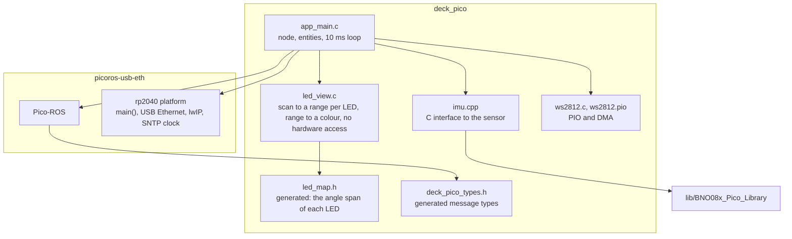

# deck_pico

Firmware of the HARP3 deck board: a Raspberry Pi Pico (RP2040) on the deck, the
level above the mobile base, for what is not the base. The mobile base board drives
the wheels and reads the odometry sensor and the limit switches; this one publishes
a BNO085 IMU and lights a ring of 57 WS2812B LEDs around the robot in a gradient by
obstacle distance: carmine at 14 cm, forest green from 60 cm. The servos and pumps
are to join it. It appears in the ROS 2 graph as the node `/deck_pico`, on the same
stack as
[`mobile_base_pico`](../mobile_base_pico/README.md): Pico-ROS on zenoh-pico over
Ethernet over USB, on the `rp2040` platform of
[`picoros-usb-eth`](https://github.com/robotcopper/picoros-usb-eth).

This is a prototype. It moves with the mobile base board: when that one is ported
to micro-ROS over `rmw_zenoh_pico` (HARP3_ROS's ADR 0011), this one follows.
HARP3_ROS's ADR 0012 records why a second board runs ROS before then.

Build and flash work as for the mobile base, see the [repository README](../README.md),
from this directory.

## ROS interface

| Entity | Type | QoS | Behaviour |
| --- | --- | --- | --- |
| `imu/bno085`, published | `sensor_msgs/Imu` | best effort, depth 5 | 100 Hz, frame `imu_link`, in the sensor's own axes |
| `scan`, subscribed | `sensor_msgs/LaserScan` | best effort, depth 5 | the YDLIDAR driver's topic; drives the ring |
| `deck_pico/status`, published | `std_msgs/String` | best effort, depth 5 | every 5 s, the board's only console; see [Lifecycle](#lifecycle) |

The board publishes no TF and has no parameters. `imu_link` and its transform to
`base_link` belong in the robot description once the sensor's mounting is fixed.

### The IMU

| Message field | Source |
| --- | --- |
| `orientation` | game rotation vector, from the gyroscope and accelerometer only |
| `angular_velocity` | calibrated gyroscope, rad/s |
| `linear_acceleration` | accelerometer, gravity included (REP-145), m/s^2 |

The game rotation vector does not use the magnetometer, which the stepper motors
disturb: its heading is relative to the one at start-up and drifts slowly, which is
what a heading fed to an EKF next to the odometry sensor wants. Building with
`-DIMU_USE_MAGNETOMETER=1` selects the rotation vector instead: absolute heading,
and an accuracy estimate for the covariance.

Covariances are the data sheet's nominal figures, as in the earlier micro-ROS
example: 0.054 rad/s for the gyroscope, 0.35 m/s^2 for the accelerometer, and 0.035 rad
for an orientation that reports no accuracy. The message is stamped with the host
clock at the read and waits for the first SNTP answer, like the mobile base's.

The earlier example in
[uros_pico_exemples](https://github.com/robotcopper/uros_pico_exemples/tree/main/uros_BNO085)
enabled only the rotation vector, so its gyroscope and acceleration stayed at zero,
and cast the stamp's seconds to 16 bits. Both are fixed here.

### The ring

Each LED shows the nearest obstacle in the directions it faces, seen from the lidar,
which sits at the centre of `base_link`. A beam counts when it is finite, no nearer
than the scan's `range_min` nor 14 cm (`IGNORE_RANGE_M`) and no farther than its
`range_max`: the Tmini Plus reports 0 for a point it missed, and that must not light
red; within 14 cm, the reach of the plate's lobes, the lidar sees the robot itself.

| Ring | Meaning |
| --- | --- |
| forest green to carmine | every lidar answered within 0.5 s: the nearest obstacle in this LED's directions, carmine (#960018) at `IGNORE_RANGE_M` (0.14 m), olive gold at 0.37 m, forest green (#228B22) from `FAR_RANGE_M` (0.60 m) and with nothing in sight |
| dim white, steady | session open, but a lidar is silent: nothing is known |
| blue, breathing | no session with the host yet |

The gradient is interpolated in HSV, its hue turning through the warm side, so its
middle is a muted gold rather than the brown a mix in RGB gives. The colours are a
screen's, and the strip shows them as a screen would: the driver applies a screen's
gamma of 2.2, which a WS2812B's linear output lacks, and FastLED's colour correction
for a typical strip, green at 176 and blue at 240 of 255 (`BOARD_LED_GAIN_*`), since
its green and blue outshine its red. Without them every mix comes out pale and cold.
The distances
are measured from the lidar, not from the edge of the robot. Both are in
`include/led_view.h`, and the colour in `led_view_color()` in `src/led_view.c`.
`LED_SECTORS[i].radius_m` holds the distance from the lidar to each LED, if they are
ever measured from the edge.

Several lidars: add a line to `lidar_sources` in `src/app_main.c`, a topic and the
lidar's rotation in `base_link`. The ring shows the nearest of them and turns dim
white as soon as one is silent.

### The strip

The ring is the first 94 cm of a 60 LEDs per metre strip: 57 LEDs, 56 of which
measure 92 cm on the test strip, laid along the
outline of the plate. Nothing past 94 cm lights: every frame carries 300 LEDs
(`BOARD_LED_STRIP_PIXELS`), and those past the ring are black, since a WS2812B keeps
its last colour until told otherwise. A longer test strip, up to a 5 m reel, stays
dark beyond the ring; on the final strip the extra data leaves its far end. The test
strip's first four LEDs were dead, and the first of them stopped the signal for the
rest: they are cut off. The drawing it was measured on is
`base_link+otos Drawing.svg`, a top view that shares ROS's axes, `+x` being the lobe
on the right, one of the three wheels. LED 0 sits at the middle of the chamfer of the
notch at -60 degrees, and the strip runs anticlockwise seen from above: first towards
the `+x` lobe. The direction is not fixed on the robot yet; `DIRECTION` in
`tools/gen_led_map.py` flips it.

The outline is 932 mm and the ring 936 mm, so it is laid on the outline
proportionally, each LED covering 1/57 of it. Seen from the lidar a LED spans from
2.8 degrees along the lobes' sides to 12.5 degrees at the notches, and the spans tile
the circle: each direction belongs to exactly one LED. A ring shorter than the outline
keeps its pitch instead, and its first and last LED share the gap.

`tools/gen_led_map.py` computes `include/led_map.h` from the outline's 18 vertices.
Change the LED count, the start or the direction there and run it: the output is
committed, the firmware build needs no Python.

## Hardware

| Function | Pins | Notes |
| --- | --- | --- |
| BNO085 | I2C0, SDA GP4, SCL GP5, address 0x4A | the pins and address of BNO08x_Pico_Library; no interrupt or reset line |
| WS2812B data | GP0, physical pin 1 | `BOARD_LED_STRIP_PIN`, PIO0, fed by DMA |
| Debug output | none | GP0 is UART0's TX, so the UART console is off; `deck_pico/status` stands in for it, and USB carries the network link |
| LED | on-board | blinks fast while waiting for the host, lit while the IMU answers |

**Power the strip from its own 5 V supply, never from the Pico's VBUS.** The ring's
57 LEDs lit white at full scale draw up to 3.4 A. The firmware caps the output at 160
of 255 (`BOARD_LED_BRIGHTNESS`); the gradient's colours are dark once
gamma-corrected, and the ring draws under 0.3 A. Connect the
supply's ground to the Pico's and put 1000 uF across the strip's supply.

GP0 drives DIN directly through 470 ohms in series. A WS2812B's input high starts at
0.7 times its supply, 3.5 V at 5 V, but the robot's strip takes the Pico's 3.3 V, as
in
[Raspberry Pi's own example](https://www.raspberrypi.com/news/how-to-power-loads-of-leds-with-a-single-raspberry-pi-pico/).
A strip that does not would need DIN at 5 V, from one of:

* a 74AHCT125 powered at 5 V, GP0 into `1A`, `1Y` to DIN through 330 ohms, `1OE`
  grounded: non-inverting, nothing to change in the firmware;
* one NPN transistor, BC547B, in common base: base to the Pico's 3V3 (pin 36)
  through 2.2 kohm, emitter to GP0, collector to DIN with 1 kohm up to the
  strip's 5 V. GP0 low turns it on and pulls DIN low; GP0 high reverse-biases the
  emitter, which sweeps the stored charge out at once, and the 1 kohm pulls DIN up
  to 5 V. Non-inverting, nothing to change in the firmware;
* or the same transistor as an inverter, emitter grounded and GP0 through 2.2 kohm
  to the base, with `BOARD_LED_STRIP_INVERTED` set to 1 in `include/board.h`. It
  needs a capacitor across the 2.2 kohm, 100 pF or 100 nF in series with 220 ohms:
  without one, the base's stored charge leaves only through the resistor, the
  transistor turns off some hundreds of nanoseconds late, and the 375 ns pulse of a
  0 shrinks below the 220 ns the LED needs.

## Network

The board is 192.168.8.1 and leases 192.168.8.2 to the host, not the 192.168.7.x of
the mobile base: two boards on one host need two subnets. Next to what
[picoros-usb-eth](https://github.com/robotcopper/picoros-usb-eth#host-setup) asks for the
mobile base, the host needs, for this one:

```sh
echo "allow 192.168.8.0/24" | sudo tee -a /etc/chrony/conf.d/harp3-usb.conf
sudo systemctl restart chrony
# and the firewall rule that admits 192.168.7.0/24, for 192.168.8.0/24:
# TCP 7447 (the router) and UDP 123 (SNTP)
```

The subnet is `USB_NET_DEVICE_IP` and `USB_NET_HOST_IP` in `CMakeLists.txt`.

`FRAG_MAX_SIZE` is raised to 8192 there. A scan of 500 beams with intensities is 4064
bytes and fits zenoh-pico's default 4096, but 520 beams or more would not, and every
such scan would be dropped. The firmware reads up to 720 beams (`MAX_BEAMS`). The
driver's `intensity: false` halves the message.

## Software



| Context | Priority | Runs |
| --- | --- | --- |
| Application task | idle + 2 | `app_main()`: start-up, then every 10 ms the watchdog, the IMU read and publication, and every 20 ms the ring |
| zenoh-pico read task | 16 | `scan_cb()`: the scan folded into one range per LED |
| zenoh-pico lease task | 16 | keepalives and the session's expiry |
| lwIP thread | 20 | TCP/IP, the DHCP server and the SNTP client |
| TinyUSB task | 22 | the USB device and its network function |

`scan_cb()` hands its result to the application task under a critical section: a copy
of 57 floats and a stamp.

### Lifecycle

A cold start opens the sensor and the strip, then starts the link. While the host is
unreachable the ring breathes blue. Once the session is open the board declares the
node, arms a 5 s watchdog, and publishes. A lost session restarts the board warm, as
on the mobile base: closing a zenoh-pico session and opening another hangs it. The
sensor stays powered and is opened again at start-up. A sensor that is absent, silent
for half a second, or that resets by itself is opened again every 2 s, after the bus
is clocked out, without stopping the ring. A sensor that answers nothing at all, on a
bus whose lines are both high, needs its power cut: unplug the board.

The application task runs below zenoh-pico's and lwIP's, which hold it for up to
3 ms in the middle of an I2C transfer while a scan is decoded. The library's 5 ms
transfer timeout is raised to 50 ms so that such a pause does not cut a transfer
short and leave the sensor out of step.

Every 5 s the board publishes on `deck_pico/status` one line: how it started, the sensor's state and, when it is not open, why and which
addresses answer on its bus with the level of SDA and SCL; how many reports came
from the sensor and how many messages went out; the SNTP state; the scans taken and
rejected, and the longest scan callback; the frames sent to the strip, the level
changes read back on its pin during 100 us of one, and the colour of LED 0; the
lowest the FreeRTOS heap has been.

A strip that stays dark while the frames go out and the pin toggles, about 100
changes, is a wiring fault or a dead first LED: data into the `DOUT` end instead of
`DIN`, the data on the wrong pin, the strip unpowered, a 3.3 V signal too low for a
strip at 5 V, or a first LED that loads DIN down and passes nothing on. Cut that LED
off and change `LED_COUNT`.

## Check

```sh
source /opt/ros/lyrical/setup.bash
export RMW_IMPLEMENTATION=rmw_zenoh_cpp
ip -br addr | grep enx            # the board's interface, holding 192.168.8.2
ros2 node list                    # /deck_pico
ros2 topic hz /imu/bno085         # about 100 Hz
ros2 topic echo /imu/bno085 --once
ros2 topic echo /deck_pico/status --qos-reliability best_effort --full-length
```

Flat on a table, `linear_acceleration.z` is about 9.8 and the quaternion is near
`(0, 0, 0, 1)` after start-up.

Without a lidar, `tools/fake_scan.py` publishes the driver's kind of scan:

```sh
tools/fake_scan.py --angle 0 --range 0.15      # the ring is red at +x
tools/fake_scan.py --angle 90 --angle -90      # and at both sides
tools/fake_scan.py --sweep 20                  # a red spot turning at 20 deg/s
tools/fake_scan.py --missed 0.3                # 30 % of the beams report 0: still green
```

With the lidar, run its driver, then bring a hand towards each lobe and each notch
and check that the LEDs facing it go from forest green through gold to carmine, and
the others stay green. `/scan` is
published in `laser_frame`, which the YDLIDAR launch file of HARP3_ROS places at
`base_link` with no rotation; a lidar mounted turned needs its angle in
`lidar_sources`.

## Tests

`test/run.sh` runs on the host: it checks that `led_map.h` is what its generator
writes, and tests `led_view.c`, with the sanitizers on. The scan-to-LED path and the
message encoding were also checked against `rclpy`'s own serialisation of a
`LaserScan` and an `Imu`.

## Files

| Path | Role |
| --- | --- |
| `src/app_main.c` | node, entities, start-up, 10 ms loop, restart |
| `src/led_view.c` | scan to a range per LED, range to a colour, without hardware access |
| `src/imu.cpp` | C interface to the BNO085 |
| `src/ws2812.c`, `src/ws2812.pio` | the strip on PIO0 and DMA |
| `include/board.h` | pins and brightness |
| `include/led_map.h` | the angle span of each LED, generated |
| `include/deck_pico_types.h` | message types and their hashes, generated |
| `lib/BNO08x_Pico_Library` | submodule, the BNO08x driver |
| `test/` | host unit tests: `test/run.sh` |
| `tools/gen_led_map.py` | regenerates `led_map.h` |
| `tools/gen_types.sh` | regenerates `deck_pico_types.h` |
| `tools/fake_scan.py` | a synthetic scan, to try the ring without a lidar |

## Message types

As for the mobile base, the firmware compiles in the type hash of every message it
exchanges. After a ROS distribution upgrade, regenerate, commit and reflash:

```sh
tools/gen_types.sh
```

It uses the generator and the checks of `mobile_base_pico/tools/gen_types.sh`, and
leaves `harp3_msgs` out: this board exchanges no type of it.
