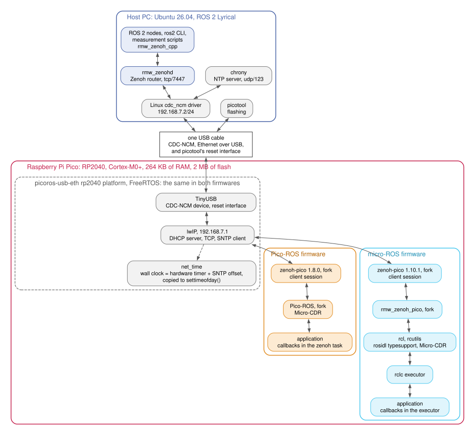
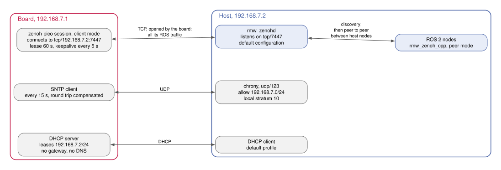
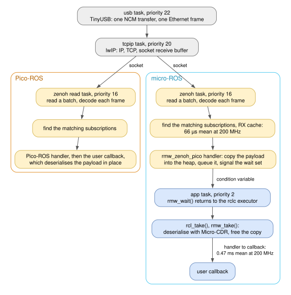
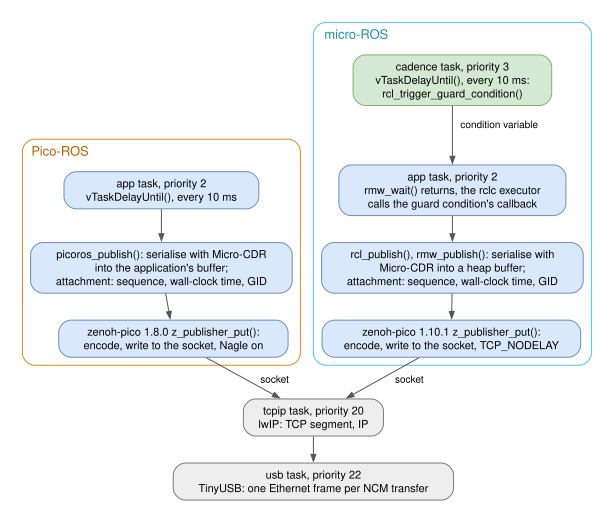
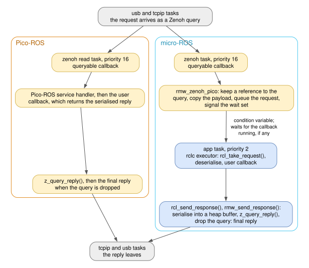
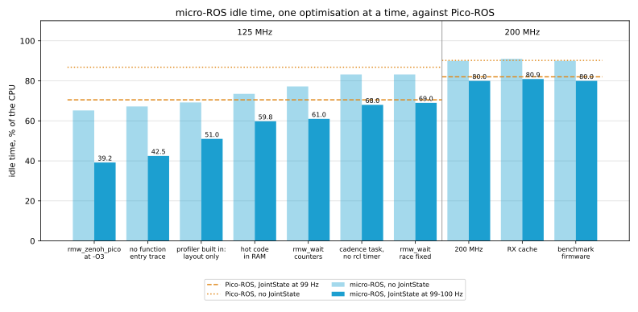
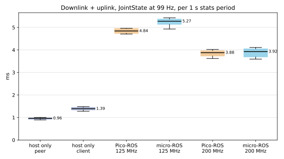
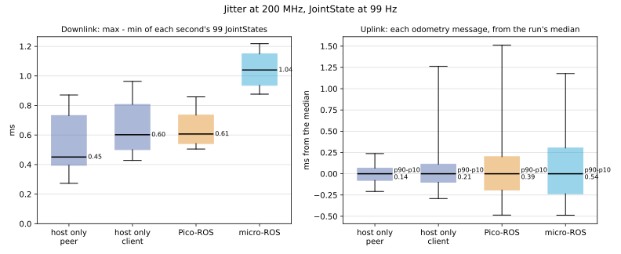
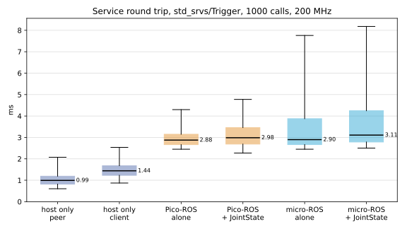

<br>

# <span style="color:#e08a1e">**Pico-ROS**</span> vs <span style="color:#47c7ef">**micro-ROS**</span> over Zenoh on the <span style="color:#c41f4c">**Raspberry Pi Pico**</span>

<br>

## Content
<hr style="height: 1px; background-color: #dfe2e5; border: none;">

- [Introduction](#introduction)
- [Summary](#summary)
- [Architecture](#architecture)
- [Inside the board](#inside-the-board)
- [The two test firmwares](#the-two-test-firmwares)
- [Method](#method)
- [CPU load](#cpu-load)
- [Latency](#latency)
- [Jitter](#jitter)
- [Services](#services)
- [Transient local](#transient-local)
- [Clock synchronisation](#clock-synchronisation)
- [Memory](#memory)
- [What had to be fixed](#what-had-to-be-fixed)
- [Conclusion](#conclusion)
- [Reproducing the measurements](#reproducing-the-measurements)
- [References](#references)

<br>

## Introduction
<hr style="height: 1px; background-color: #dfe2e5; border: none;">

The mobile base of the HARP3 robot is driven by a <span style="color:#c41f4c">**Raspberry Pi Pico**</span>, which has to be a node of a <span style="color:#4762a6">**ROS 2**</span> Lyrical stack running on `rmw_zenoh_cpp`. The usual <span style="color:#47c7ef">**micro-ROS**</span> setup cannot do that: its agent bridges XRCE-DDS to DDS and does not speak Zenoh. Two stacks put a microcontroller on Zenoh directly, without an agent:

- <span style="color:#e08a1e">**Pico-ROS**</span>, a small C library that maps ROS 2 entities onto [zenoh-pico](https://github.com/eclipse-zenoh/zenoh-pico), with an API of its own.
- <span style="color:#47c7ef">**micro-ROS**</span> with [rmw_zenoh_pico](https://github.com/esol-community/rmw_zenoh_pico): the standard micro-ROS client libraries, `rcl` and `rclc`, over an rmw that writes what `rmw_zenoh_cpp` expects. The application is ordinary `rclc` code; only the rmw changes.

This page compares the two on the same board, link, host and application. It covers CPU load at 125 and 200 MHz, publish/subscribe latency and jitter, services, transient local durability, clock synchronisation and memory. It explains how each figure was measured and what had to be fixed in each stack to get there. Both test firmwares, the measurement scripts and the raw results are in [`benchmarks/`](https://github.com/robotcopper/HARP3_uC/tree/main/benchmarks) and [`results/`](https://github.com/robotcopper/HARP3_uC/tree/main/docs/picoros_vs_microros/results).

<br>

## Summary
<hr style="height: 1px; background-color: #dfe2e5; border: none;">

At 200 MHz, once fixed, the two stacks are on par for median latency and CPU load. <span style="color:#47c7ef">**micro-ROS**</span> uses more memory and has longer tails on services and on the downlink, because its callbacks wait for the executor.

| 200 MHz, JointState at 99 Hz | Pico-ROS | micro-ROS |
| --- | --- | --- |
| Idle time, odometry only / with JointState | 90.2 / 82.0 % | 90.0 / 80.0 % |
| Downlink + uplink, median | 3.88 ms | 3.92 ms |
| Downlink spread within one second, median | 0.61 ms | 1.04 ms |
| Service round trip, median / 90th percentile / maximum | 2.88 / 3.15 / 4.30 ms | 2.90 / 3.87 / 7.76 ms |
| Late joiner on a transient local topic | 3.3 to 5.3 ms | 3.2 to 3.6 ms |
| Flash | 260 KB | 369 KB |
| FreeRTOS heap left, of 128 KB | 57.7 KB | 30.6 KB |
| RAM left for `malloc()` | 63.9 KB | 9.3 KB |

At 125 MHz, the RP2040's default clock, <span style="color:#e08a1e">**Pico-ROS**</span> keeps a small lead: 70.5 % idle against 69.0 % with JointState, and 4.84 ms against 5.16 to 5.27 ms of downlink + uplink.

HARP3 adopts <span style="color:#47c7ef">**micro-ROS**</span> for its standard API, the reasons being given in the [conclusion](#conclusion). These figures hold only with the fixes listed in [What had to be fixed](#what-had-to-be-fixed), which live in forks of zenoh-pico and rmw_zenoh_pico until they are merged upstream.

<br>

## Architecture
<hr style="height: 1px; background-color: #dfe2e5; border: none;">

<div style="display: flex; justify-content: center;">
    
</div>

One USB cable carries everything. The board presents itself as a USB Ethernet adapter (CDC-NCM, a standard class with a built-in driver on Linux), and also exposes the reset interface that `picotool` uses to flash it while it runs. The layers below Zenoh come from [picoros-usb-eth](https://github.com/robotcopper/picoros-usb-eth)'s rp2040 platform and are identical in both firmwares: FreeRTOS, TinyUSB, lwIP and the SNTP clock. Everything from zenoh-pico up differs:

| Layer | Pico-ROS firmware | micro-ROS firmware |
| --- | --- | --- |
| Application API | Pico-ROS | `rclc` and `rcl`, Lyrical, pinned in [`microros.repos`](https://github.com/robotcopper/HARP3_uC/blob/main/benchmarks/microros_rp2040_basic/microros.repos) |
| ROS to Zenoh mapping | Pico-ROS itself | rmw_zenoh_pico, fork, branch `lyrical` plus 11 patches |
| Zenoh | zenoh-pico 1.8.0, fork | zenoh-pico 1.10.1 plus 4 patches |
| Serialisation | Micro-CDR | Micro-CDR, through `rosidl_typesupport_microxrcedds` |
| Message types | generated by Pico-ROS's `type-gen` | generated by `rosidl` from the `.msg` files |

The host runs Ubuntu 26.04, ROS 2 Lyrical and `rmw_zenoh_cpp` 0.10.6, whose router `rmw_zenohd` bundles Zenoh 1.8.0; zenoh-pico 1.10.1 works with it unchanged. The firmwares are built with the Pico SDK 2.2.0, the FreeRTOS kernel at 8be86d4 and `arm-none-eabi-gcc` 14.2.

<div style="display: flex; justify-content: center;">
    
</div>

The board runs a DHCP server on the link and leases 192.168.7.2 to the host, without a gateway or DNS. It opens one TCP connection to the router on 7447 as a Zenoh client and synchronises its clock on the host's `chrony` over SNTP. Host nodes find each other through the router and then exchange data directly. The board, being a client, sends all its traffic through the router.

Both stacks write exactly what `rmw_zenoh_cpp` writes:

- one key expression per topic, `<domain>/<name>/<type>/RIHS01_<type hash>`;
- liveliness tokens `@ros2_lv/...` for the graph;
- an attachment on each sample with a sequence number, the source timestamp and the publisher's GID.

So `ros2 node list`, `ros2 topic echo` and `ros2 service call` see the board like any other node.

**No agent, standard API.** The micro-ROS agent only exists for `rmw_microxrcedds`. Here `rmw_zenoh_pico` replaces it: `libmicroros.a` is built from the workspace that `micro_ros_setup`'s `generate_lib` creates, with `rmw_zenoh_pico` in place of `rmw_microxrcedds`. The application calls only `rcl` and `rclc`: `rclc_support_init()`, `rclc_node_init_default()`, `rclc_publisher_init_*()`, `rclc_service_init_default()` and `rclc_executor_*()`. The benchmark firmware adds three non-standard pieces:
- a `clock_gettime()` that newlib leaves to the platform;
- two instrumentation headers, the `rmw_wait` counters and the subscription lookup timing;
- the address of the router, set at build time.

<br>

## Inside the board
<hr style="height: 1px; background-color: #dfe2e5; border: none;">

| Task | Priority | Runs | In |
| --- | --- | --- | --- |
| `usb` | 22 | TinyUSB device stack and CDC-NCM | both |
| `tcpip` | 20 | lwIP | both |
| zenoh | 16 | zenoh-pico's background work, 4 KB stack. Pico-ROS (1.8.0): a read task and a lease task. micro-ROS (1.10.1): one task doing both | both |
| `cadence` | 3 | wakes the executor every 10 ms | micro-ROS |
| `app` | 2 | the application, 32 KB stack: Pico-ROS's loop, or the `rclc` executor | both |
| `IDLE` | 0 | idle time, what the CPU figures report | both |

The one structural difference between the stacks is the task in which a callback runs.

<div style="display: flex; justify-content: center;">
    
</div>

In <span style="color:#e08a1e">**Pico-ROS**</span>, a subscription callback runs in the zenoh read task, at priority 16, as soon as the sample is decoded. It preempts the application loop.

In <span style="color:#47c7ef">**micro-ROS**</span>, the zenoh task only copies the sample into the heap, queues it and signals the wait set. The callback runs in the `app` task, when the executor gets to it. If the executor is busy, for instance publishing the odometry (about 0.7 ms at 200 MHz) or running another callback, the sample waits. This explains most of the differences in tails measured below.

<div style="display: flex; justify-content: center;">
    
</div>

Publishing is similar in both: the application serialises the message with Micro-CDR, adds the attachment and hands it to zenoh-pico, which writes it to the lwIP socket. Two differences: `rmw_zenoh_pico` allocates the serialisation buffer from the heap at each publication, and zenoh-pico 1.10.1 sets `TCP_NODELAY` where 1.8.0 leaves Nagle's algorithm on. The micro-ROS firmware wakes its executor with a guard condition rather than an `rcl` timer, for the reason given in [CPU load](#cpu-load).

<div style="display: flex; justify-content: center;">
    
</div>

Services follow the same split as subscriptions. <span style="color:#e08a1e">**Pico-ROS**</span> answers in the zenoh task. <span style="color:#47c7ef">**micro-ROS**</span> queues the request and answers from the executor.

<br>

## The two test firmwares
<hr style="height: 1px; background-color: #dfe2e5; border: none;">

[`benchmarks/picoros_rp2040_basic`](https://github.com/robotcopper/HARP3_uC/tree/main/benchmarks/picoros_rp2040_basic) is picoros-usb-eth's `rp2040_basic` example with a service added. [`benchmarks/microros_rp2040_basic`](https://github.com/robotcopper/HARP3_uC/tree/main/benchmarks/microros_rp2040_basic) declares the same entities with `rclc`:

| Entity | Type | QoS | Purpose |
| --- | --- | --- | --- |
| `pico/boot` | `std_msgs/String` | reliable, transient local, depth 1 | published once per session: how the board started |
| `pico/odom` | `nav_msgs/Odometry` | best effort | every 10 ms, stamped with the SNTP clock: the uplink |
| `pico/stats` | `std_msgs/String` | best effort | every second: downlink delays, idle time, heap, SNTP |
| `topic_based_joint_commands` | `sensor_msgs/JointState` | best effort | subscribed and timed: the downlink |
| `pico/ping` | `std_srvs/Trigger` | service | answers at once, so that a call times the stack |

They differ where the stacks do:

- **Cadence.** Pico-ROS's application loop sleeps with `vTaskDelayUntil()` for 10 ms. In micro-ROS a `cadence` task does that and triggers a guard condition, whose callback in the executor publishes the odometry and, every hundredth time, the stats.
- **Downlink timing.** Pico-ROS gives the callback the sample's metadata, so its firmware times the downlink from the source timestamp in the rmw attachment. `rclc` gives no message info to a subscription callback, so the micro-ROS firmware times it from `header.stamp`. The host's publisher sets the attachment 0.12 ms after `header.stamp` on average (`stamp_gap.py`), and the Pico-ROS sums below are corrected by that amount.
- **Instrumentation.** The micro-ROS firmware also reports the CPU share of each task, the XIP cache counters, what `rmw_wait()` did, and when each sample reached `rmw_zenoh_pico`. It can also sample its program counter for profiling. Together these cost about one point of idle time.
- **Code in RAM.** The micro-ROS firmware runs its 183 hottest functions, 16.2 KB chosen from a profile, from RAM ([`hot_functions.txt`](https://github.com/robotcopper/HARP3_uC/blob/main/benchmarks/microros_rp2040_basic/hot_functions.txt)). Pico-ROS needs none.
- **Restart report.** After a panic, a hard fault or a watchdog timeout, the micro-ROS firmware parks with only USB up. Its report can then be read from RAM with `picotool`, which is how the crashes in [What had to be fixed](#what-had-to-be-fixed) were diagnosed.

<br>

## Method
<hr style="height: 1px; background-color: #dfe2e5; border: none;">

**Setup.** One Raspberry Pi Pico, plugged into the host that runs `rmw_zenohd` with its default configuration and `chrony`. The scripts run on that host, which is otherwise idle. Each firmware is built in Release and flashed with `picotool load -f -x`.

**Publish/subscribe, [`measure.py`](https://github.com/robotcopper/HARP3_uC/blob/main/benchmarks/tools/measure.py).** It runs three phases:

1. 30 s subscribed to `pico/odom` and `pico/stats`.
2. 30 s with JointState published on `topic_based_joint_commands` at 99 Hz, stamped at publication.
3. 21 s with 100 ICMP pings added.

It records:

- **Uplink:** for each odometry message, the host's reception time minus its `header.stamp`, which is the board's clock.
- **Downlink:** the board's reception time minus the JointState's stamp, which is the host's clock. The board averages it over each second and reports the average and the spread, maximum minus minimum.
- **Idle time:** the share of FreeRTOS's idle task, from its run-time statistics.

Each one-way delay contains the offset between the two clocks, with opposite signs, so only their sum is free of it:

```
downlink + uplink = (board_rx - host_tx + offset) + (host_rx - board_tx - offset)
```

The sum is computed for each stats period, and only sums are compared. Two runs of related firmwares at 125 MHz show why. Their downlink averages were +3.5 ms and -3.3 ms, yet both sums were 4.75 ms.

**Why 99 Hz.** The board publishes every 10 ms of its clock. A host publishing at 100 Hz then keeps the same phase relative to it for a whole run, so every JointState meets the board at the same point of its cycle: always during the odometry publication, or never. Two 100 Hz runs of nearly identical firmwares gave sums of 4.74 and 5.77 ms. At 99 Hz the phase sweeps the 10 ms period once a second, so each stats period averages all of them; the second firmware then gave 5.16 ms.

**Services and late joiners, [`service_rtt.py`](https://github.com/robotcopper/HARP3_uC/blob/main/benchmarks/tools/service_rtt.py).**

- **Late joining:** a new reliable, transient local subscription to `pico/boot` waits for the message the board published when it started. The script times from the creation of the subscription to the message, five times.
- **Round trip:** 1000 calls of `pico/ping`, each sent 10 to 20 ms after the previous answer, at random, so that the calls meet every phase of the board's cadence. The round trip runs from `call_async()` to the completed future, on the host's clock alone. This is done once with the odometry subscribed, then again with JointState at 99 Hz.

**Host reference, [`host_reference.py`](https://github.com/robotcopper/HARP3_uC/blob/main/benchmarks/tools/host_reference.py).** The same exchanges with a stand-in for the board on the host, in two modes:
- peer, the default of `rmw_zenoh_cpp`, where data goes directly between processes;
- client, where data crosses the router as the board's does.

This gives the share of the host and of the router.

**Profiling.** The micro-ROS firmware can sample its program counter from a timer interrupt that runs from RAM, so as not to disturb the cache it measures.
- `profile_report.py` maps the samples to functions.
- `hot_functions.py` picks the densest functions for a RAM budget.
- `rename_hot.py` moves their sections into the region the Pico SDK copies to RAM.

**Limits.** One board, one host and runs of 30 s. The code layout alone moves idle time by several points: with the XIP cache, a firmware whose hot path did not change gained 8.5 points. Differences below 1 to 2 points of idle, or 0.1 to 0.15 ms of latency, are not significant here.

<br>

## CPU load
<hr style="height: 1px; background-color: #dfe2e5; border: none;">

| Idle time | 125 MHz, odometry only | 125 MHz, + JointState 99 Hz | 200 MHz, odometry only | 200 MHz, + JointState 99 Hz |
| --- | --- | --- | --- | --- |
| Pico-ROS | 86.8 % | 70.5 % | 90.2 % | 82.0 % |
| micro-ROS | 83.2 % | 69.0 % | 90.0 % | 80.0 % |

At 200 MHz a JointState costs 0.83 ms of CPU in Pico-ROS and 1.0 ms in micro-ROS. That is 8.2 and 10.0 points of idle time for 99 messages a second. In micro-ROS the time with JointState splits into:
- 11.1 % in the `app` task (executor, serialisation, application);
- 4.7 % in zenoh;
- 2.2 % in `tcpip`;
- 1.1 % in `usb`.

zenoh-pico spends 66 to 68 µs of it finding the subscriptions of each sample. Its RX cache brought that down from 82 µs to 59 µs in the run that introduced it.

micro-ROS did not start there:

<div style="display: flex; justify-content: center;">
    
</div>

1. **First build: 34 to 37 % idle with JointState**, measured by hand before `measure.py` existed. rmw_zenoh_pico forced `-O0` and traced every function entry: each entry formatted a 64-byte string before testing the log level.
2. **`-O3`, then no entry trace: 39.2 %, then 42.5 %.**
3. **Profiler built in: 51.0 %.** The code that ran was the same. Only its placement in flash changed, and with it the XIP cache misses, from 1.12 to 0.97 million per second. The RP2040 runs code from QSPI flash through a 16 KB cache, and this firmware was bound by flash fetches.
4. **Hot code in RAM: 59.8 %.** The 183 functions with the most samples per byte, plus the SDK's divider, were moved to RAM. Cache misses fell to 0.52 million per second.
5. **`rmw_wait` counters: 61.0 %.** These counters exposed polling: 626 calls to `rmw_wait()` per second without JointState, 503 of them shorter than a millisecond. zenoh-pico's clock on this port is the FreeRTOS tick, and `rmw_wait()` rounds its timeout down to whole ticks. The executor therefore woke before an `rcl` timer was due, found nothing, and spun until it was.
6. **A cadence task instead of an `rcl` timer: 68.0 %.** `rmw_wait()` now returns 100 times a second without JointState, every time because the guard condition was signalled. This needed two fixes in rmw_zenoh_pico's guard conditions and one in `rmw_wait()`, listed in [What had to be fixed](#what-had-to-be-fixed). The last one gives 69.0 %.
7. **200 MHz: 80.0 %.** `PICO_USE_FASTEST_SUPPORTED_CLOCK` sets the PLL and raises the core voltage to 1.15 V; the flash then runs at 100 MHz.
8. **RX cache, `Z_FEATURE_RX_CACHE`: 80.9 %,** within the noise for CPU, but 23 µs less per received sample.
9. **The benchmark firmware: 80.0 %.** It adds transient local, the services and the leak fix.

What is left of the gap at 200 MHz, two points with JointState, is about the micro-ROS firmware's extra instrumentation and its executor.

<br>

## Latency
<hr style="height: 1px; background-color: #dfe2e5; border: none;">

<div style="display: flex; justify-content: center;">
    
</div>

| Downlink + uplink, median per stats period | 125 MHz | 200 MHz |
| --- | --- | --- |
| Host only, peer | 0.96 ms | |
| Host only, client, through the router | 1.39 ms | |
| Pico-ROS, corrected by 0.12 ms | 4.84 ms | 3.88 ms |
| micro-ROS | 5.27 ms, 5.16 ms in another run | 3.92 ms |
| ICMP round trip, mean, Pico-ROS / micro-ROS | 1.27 / 1.02 ms | 0.96 / 0.76 ms |

The board dominates: 3.9 ms against 1.4 ms when both ends are on the host and the data crosses the router. The micro-ROS firmware stamps each sample when it reaches `rmw_zenoh_pico`, which splits its 5.27 ms at 125 MHz:

- **Host and router: about 0.78 ms.** That is one way from publication to the rmw (0.35 ms), plus two router crossings (0.22 ms each).
- **Link: 0.6 to 1.0 ms**, the ICMP round trip, which lwIP answers alone.
- **Executor: 0.85 ms** from `rmw_zenoh_pico` to the callback, 0.47 ms at 200 MHz.
- **The rest: 2.6 to 3.0 ms of board software:**
  - lwIP;
  - zenoh-pico decoding and encoding;
  - serialising the odometry;
  - TinyUSB.

The clock shortens the sum by 26 % for 60 % more frequency: part of the time is spent waiting on the link and the host, not computing.

<br>

## Jitter
<hr style="height: 1px; background-color: #dfe2e5; border: none;">

<div style="display: flex; justify-content: center;">
    
</div>

| 200 MHz, JointState at 99 Hz | Host, peer | Host, client | Pico-ROS | micro-ROS |
| --- | --- | --- | --- | --- |
| Downlink, maximum - minimum within each second, median | 0.45 ms | 0.60 ms | 0.61 ms | 1.04 ms |
| Uplink, 10th to 90th percentile | 0.14 ms | 0.21 ms | 0.39 ms | 0.54 ms |

micro-ROS adds about 0.4 ms of downlink spread. A JointState that arrives while the executor is publishing the odometry waits for it: from `rmw_zenoh_pico` to the callback, the spread within a second is 0.73 ms. In Pico-ROS, the callback runs in the zenoh task and preempts the publication.

The micro-ROS benchmark firmware shows the same effect at a larger scale, once a second. It builds its stats in the executor, scanning every task's stack, which takes about 5.5 ms at 125 MHz. A JointState arriving meanwhile waits that long. At 99 Hz, whether one does depends on the run's phase: 8.5 ms of spread per second at 125 MHz in one run, nothing in the 200 MHz run above, and 5.2 ms in another 200 MHz run. This comes from the instrumentation, but the lesson applies to any micro-ROS firmware: a long callback delays every other callback. Keep callbacks short, or move the work to a task of its own.

<br>

## Services
<hr style="height: 1px; background-color: #dfe2e5; border: none;">

<div style="display: flex; justify-content: center;">
    
</div>

| Round trip, 200 MHz, 1000 calls | Median | 90th percentile | Maximum | Lost |
| --- | --- | --- | --- | --- |
| Host, peer | 0.99 ms | 1.19 ms | 2.07 ms | 0 |
| Host, client | 1.44 ms | 1.68 ms | 2.53 ms | 0 |
| Pico-ROS | 2.88 ms | 3.15 ms | 4.30 ms | 0 |
| Pico-ROS, with JointState at 99 Hz | 2.98 ms | 3.46 ms | 4.78 ms | 0 |
| micro-ROS | 2.90 ms | 3.87 ms | 7.76 ms | 0 |
| micro-ROS, with JointState at 99 Hz | 3.11 ms | 4.25 ms | 8.18 ms | 0 |

The medians are equal: the board adds about 1.45 ms to what the same call costs between two host processes through the router. The tails differ for the reason above. In micro-ROS a request waits in the queue until the executor is free:
- when the request arrives during the odometry publication, the wait is up to 0.7 ms, which shows in the 90th percentile;
- when it arrives while the 1 Hz stats are being built, the wait is several milliseconds, which gives the maximum.

Answering a call costs both stacks about the same CPU: calls arriving every 10 to 20 ms take about 10 points of idle time.

<br>

## Transient local
<hr style="height: 1px; background-color: #dfe2e5; border: none;">

| Late joiner, 5 attempts | Delay from the subscription to the message |
| --- | --- |
| Host, peer | 2.1, 1.0, 1.1, 1.1, 1.1 ms |
| Host, client | 2.6, 1.5, 1.4, 1.6, 1.1 ms |
| Pico-ROS | 4.0, 3.3, 4.2, 5.3, 4.0 ms |
| micro-ROS | 3.2, 3.6, 3.4, 3.5, 3.3 ms |

`rmw_zenoh_cpp` implements a transient local publisher as a Zenoh advanced publisher, with three features:
- a cache as deep as the history;
- publisher detection;
- sample miss detection, with a heartbeat every 500 ms unless the publisher is best effort.

A subscriber that joins late detects the publisher and queries its cache. Pico-ROS's fork declares the same publisher. rmw_zenoh_pico declared a plain publisher, so a late joiner never received anything. Its fork now declares the same advanced publisher as `rmw_zenoh_cpp`, with the same default depth of 42 when the history depth is 0. This needs zenoh-pico built with `Z_FEATURE_UNSTABLE_API` and `Z_FEATURE_ADVANCED_PUBLICATION`. Both stacks answer the late joiner's query in the zenoh task.

<br>

## Clock synchronisation
<hr style="height: 1px; background-color: #dfe2e5; border: none;">

The clock is part of the shared platform and behaves the same in both firmwares:

- **Source.** lwIP's SNTP client asks the host's `chrony`, which serves its own clock on the link (`local stratum 10`). The first request goes out once the host answers ARP, then one every 15 s.
- **Offset.** It is computed from the four timestamps of the exchange, which compensates the round trip.
- **Steps.** The board keeps the offset added to its 1 MHz hardware timer and steps it at each update, without slewing.
- **Copy for zenoh-pico.** It also copies the clock to `settimeofday()`. zenoh-pico and the attachment timestamps read it from there: directly in Pico-ROS, and through `clock_gettime(CLOCK_REALTIME)` in micro-ROS.

The steps reported at each update were -49 µs and 661 µs in the final runs, and -28, 6 and 213 µs in earlier ones. The board waits for its first answer before stamping any data. Its `pico/boot` message, which carries no stamp, goes out before that.

The offset is less accurate than these steps suggest. With the same firmware family, the downlink averages of different runs ranged from -3.3 ms to +3.5 ms, while their sums barely moved. Within a run the offset holds still; between runs it can be several milliseconds off. SNTP assumes a symmetric path. A plausible cause, not established, is that under load the reply is timestamped late by the `tcpip` task. Hence the method relies on sums only. On the robot, a board stamp can likewise be a few milliseconds off the host's clock, whichever stack runs.

<br>

## Memory
<hr style="height: 1px; background-color: #dfe2e5; border: none;">

| | Pico-ROS | micro-ROS |
| --- | --- | --- |
| Flash: code, read-only data, initial data | 260 KB | 369 KB |
| Static RAM besides the FreeRTOS heap | 63.9 KB | 118.4 KB, of which 19 KB of code in RAM |
| FreeRTOS heap, of 128 KB: left at run time | 57.7 KB | 31.8 KB at start, 30.6 KB under load |
| RAM left for `malloc()` | 63.9 KB | 9.3 KB |
| zenoh task stack, unused of 4 KB | | 1152 bytes after late joins and 2000 calls |

The RP2040 has 264 KB of RAM. micro-ROS leaves about 37 KB of it free, Pico-ROS about 120 KB. 19 KB of the difference is a deliberate trade: code moved to RAM to save CPU.

The FreeRTOS heap holds the task stacks and everything zenoh-pico and rmw_zenoh_pico allocate. The heap left stayed constant over 2000 service calls once the leak described below was fixed.

The zenoh task's stack is the tightest margin: 1152 bytes left of 4096 after late joins and 2000 service calls, against 2844 bytes at start. A stack overflow panics the board. That margin must be checked again on the mobile base firmware, whose traffic differs.

<br>

## What had to be fixed
<hr style="height: 1px; background-color: #dfe2e5; border: none;">

Neither stack worked as published. The fixes are in forks, as patch series ready for `git am`: fixes first, instrumentation last.

**zenoh-pico 1.10.1**, used by micro-ROS; the Pico-ROS fork carries the same two fixes on 1.8.0:

| Patch | Problem | Effect |
| --- | --- | --- |
| package name | rmw_zenoh_pico expects the colcon package `zenohpico` | build |
| decode every frame of a batch | a batch holding a best-effort frame then a reliable one was decoded as one frame. `rmw_zenohd` sends such batches under load | the read task stopped |
| read the pending query before releasing the lock | the reply handlers read the pending query after unlocking, while the lease task may drop it on timeout | use after free |
| time the subscription lookup | instrumentation | |

**rmw_zenoh_pico**, on the fork's `lyrical` branch, which already carries the Lyrical port and upstream pull requests:

| Patch | Problem | Effect |
| --- | --- | --- |
| build for the Raspberry Pi Pico | no port for it | |
| keep the session mutex | the session was cleared after its mutex was created. Harmless on Linux, where a zeroed mutex is valid | hard fault at start |
| initialise the service mutex | never initialised | hard fault at the first service call |
| keep the key that zenoh-pico copied into the query | a workaround for older zenoh-pico overwrote the key that 1.10.1 copies, leaking about 130 bytes per request | heap exhausted after a few hundred calls |
| optimisation level from the build type | `-O0` was forced | CPU |
| trace function entries only on request | always on | CPU |
| signal the wait set when a guard condition is triggered | the executor woke only at its timeout | latency |
| clear a guard condition's trigger on detach | spurious wake-ups | CPU |
| do not sleep once a condition has triggered | a condition triggered during `rmw_wait()` was missed until the next one | up to 10 ms of latency |
| transient local publishers | not implemented | late joiners got nothing |
| count what `rmw_wait()` does, stamp arrivals | instrumentation | |

Two problems in rmw_zenoh_pico remain unfixed because these firmwares never reach them: a mutex of the QoS event path that is never initialised, and variables left uninitialised on some error paths.

The <span style="color:#e08a1e">**Pico-ROS**</span> fork carries its own fixes, listed in [picoros-usb-eth](https://github.com/robotcopper/picoros-usb-eth#pinned-forks):
- it stamped the attachment with the time since boot rather than the wall clock;
- it resolved `~` in service names but not in topic names;
- its type generator could give a service the hash of its request.

<br>

## Conclusion
<hr style="height: 1px; background-color: #dfe2e5; border: none;">

**Performance.** At 200 MHz the two stacks are equivalent: 80 to 82 % idle with a 99 Hz command stream, and 3.9 ms of downlink + uplink. Pico-ROS keeps a structural advantage in the tails, because its callbacks run in the zenoh task: half the downlink spread and half the service maximum. At 125 MHz it is ahead by 1.5 points and 0.3 to 0.4 ms.

**Memory.** micro-ROS costs 110 KB more flash and leaves about 37 KB of RAM free against 120 KB.

**Choice.** HARP3 runs micro-ROS on its boards because its API is the standard one:
- the firmware is written with `rcl` and `rclc`, like any micro-ROS application, documented and known to the ROS community;
- message types are generated by `rosidl` from the same `.msg` files as on the host;
- callbacks follow the executor's semantics.

Moving from a serial agent to Zenoh is a change of rmw, not of application code. Pico-ROS is smaller and simpler, but its API is its own and its user base small.

**What that choice costs:**

- Two forks to maintain until their fixes are merged; rmw_zenoh_pico's upstream merges slowly.
- Callbacks must stay short, since the executor runs them one after the other. Periodic work uses a task and a guard condition, not an `rcl` timer.
- RAM is tight: 30 KB of FreeRTOS heap and 1.1 KB on the zenoh task's stack.

The next step is porting the mobile base firmware, recorded in HARP3_ROS's ADR 0011, and proposing the fixes upstream.

<br>

## Reproducing the measurements
<hr style="height: 1px; background-color: #dfe2e5; border: none;">

[`benchmarks/README.md`](https://github.com/robotcopper/HARP3_uC/blob/main/benchmarks/README.md) gives the prerequisites and the build of both firmwares. In short, with the router running:

```bash
cd benchmarks/microros_rp2040_basic        # or picoros_rp2040_basic
./create_microros_ws.sh                    # micro-ROS only, once
cmake -S . -B build/rp2040 -G Ninja -DCMAKE_BUILD_TYPE=Release
cmake --build build/rp2040
picotool load -f -x build/rp2040/microros_rp2040_basic.uf2

source /opt/ros/lyrical/setup.bash
export RMW_IMPLEMENTATION=rmw_zenoh_cpp
python3 ../tools/measure.py microros_rp2040_basic_99hz --rate 99
python3 ../tools/service_rtt.py microros_rp2040_basic_service
```

`-DPICO_USE_FASTEST_SUPPORTED_CLOCK=OFF` builds for 125 MHz. Results are written to [`results/`](https://github.com/robotcopper/HARP3_uC/tree/main/docs/picoros_vs_microros/results), whose README says which run each figure comes from. `benchmarks/tools/figures.py` redraws every chart and diagram of this page from them.

<br>

## References
<hr style="height: 1px; background-color: #dfe2e5; border: none;">

- [Pico-ROS](https://github.com/Pico-ROS/Pico-ROS-software)
- [rmw_zenoh_pico](https://github.com/esol-community/rmw_zenoh_pico), by eSOL
- [zenoh-pico](https://github.com/eclipse-zenoh/zenoh-pico)
- [rmw_zenoh](https://github.com/ros2/rmw_zenoh)
- [micro-ROS](https://micro.ros.org/) and [micro_ros_setup](https://github.com/micro-ROS/micro_ros_setup)
- [picoros-usb-eth](https://github.com/robotcopper/picoros-usb-eth)
- [RP2040 datasheet](https://datasheets.raspberrypi.com/rp2040/rp2040-datasheet.pdf), for the XIP cache and the clocks
