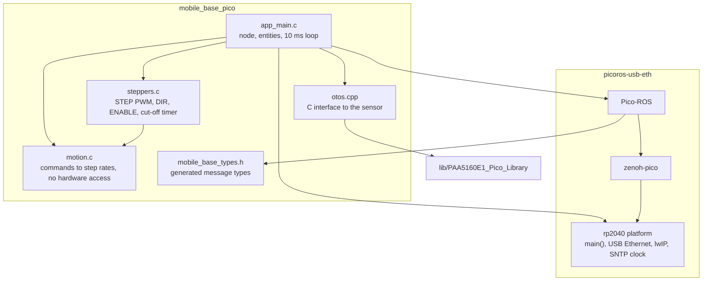
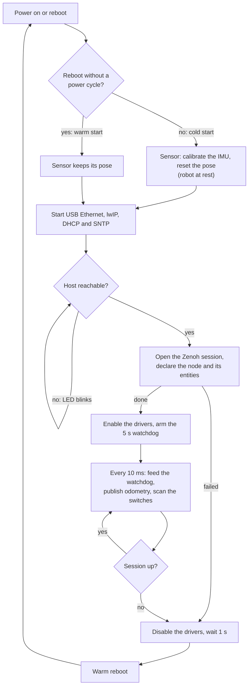

# mobile_base_pico

Firmware of the HARP3 mobile base board: a Raspberry Pi Pico (RP2040) that drives
three stepper motors, reads a PAA5160E1 optical odometry sensor and six limit
switches, and appears in the ROS 2 graph as the node `/mobile_base_pico`. It runs
Pico-ROS on zenoh-pico over Ethernet over USB, on the `rp2040` platform of
[`picoros-usb-eth`](https://github.com/robotcopper/picoros-usb-eth). HARP3_ROS's
ADR 0010 records why.

Build and flash: see the [repository README](../README.md).

## ROS interface

| Entity | Type | QoS | Behaviour |
| --- | --- | --- | --- |
| `topic_based_joint_commands`, subscribed | `sensor_msgs/JointState` | best effort | wheel speeds in rad/s, by name `wheel_1_joint` to `wheel_3_joint`, or by position when the message has no names |
| `odom/paa5160e1`, published | `nav_msgs/Odometry` | best effort, depth 5 | 100 Hz, `odom_paa5160` to `paa5160_frame`, covariances from the sensor's standard deviations |
| `limit_switches`, published | `harp3_msgs/LimitSwitches` | reliable, transient local, depth 1 | on every change, and once when the session opens |
| `reset_odometry`, served | `std_srvs/Trigger` | default | sensor back to the origin, heading zero |

A command is rejected unless it sets every wheel exactly once to a finite value.
The board publishes no TF and has no parameters.

## Hardware

| Function | Pins | Notes |
| --- | --- | --- |
| STEP, wheels 1 to 3 | GP10, GP13, GP7 | one PWM slice each, so one step rate each |
| DIR, wheels 1 to 3 | GP9, GP12, GP6 | polarity in `BOARD_DIR_INVERTED`, still to check wheel by wheel on blocks |
| ENABLE, wheels 1 to 3 | GP11, GP14, GP8 | active low |
| Limit switches 11, 12, 21, 22, 31, 32 | GP20, GP21, GP18, GP19, GP16, GP17 | closed to 3.3 V when pressed, pulled down |
| PAA5160E1 | I2C1, SDA GP26, SCL GP27 | set on the library in `CMakeLists.txt` |
| Debug output | UART0, TX GP0, RX GP1 | `printf`; USB carries the network link |
| LED | on-board | blinks fast while waiting for the host, lit while a wheel turns |

The motors are 17HS19-2004S1 in full step, the microstep inputs being
unconnected, with the wheel on the shaft: 200 steps per wheel turn. The pins
are in `include/board.h`, the motor constants in `include/motion.h`.

## Software



The work is spread over FreeRTOS tasks and one timer interrupt:

| Context | Priority | Runs |
| --- | --- | --- |
| Application task | idle + 2 | `app_main()`: start-up, then every 10 ms the watchdog, the odometry, the limit switches and the LED |
| zenoh-pico read task | 16 | the wheel command callback, and the odometry reset, which shares the I2C bus with the application task through a mutex |
| zenoh-pico lease task | 16 | keepalives and the session's expiry |
| lwIP thread | 20 | TCP/IP, the DHCP server and the SNTP client |
| TinyUSB task | 22 | the USB device and its network function |
| Timer interrupt | every 10 ms | stops the pulses once no command has arrived for 200 ms |

### Lifecycle



The board restarts instead of opening a new session: closing a zenoh-pico
session and opening another hangs it. A reboot by the watchdog, by a lost
session or by `picotool` is warm, so the sensor stays powered and keeps
tracking.

### Safety

* The motors stop when no command has arrived for 200 ms. A timer interrupt
  checks it, whatever the application task is doing, so the loss of the host,
  the router, the cable or the controller all end the same way.
* The drivers are enabled only while a session is open.
* The watchdog is armed when the session opens, fed every 10 ms and never
  disarmed: a stuck firmware restarts within 5 s.

### Time

Odometry is stamped with the host's clock, taken over SNTP from the computer the
board is plugged into, at the moment the sensor is read. Limit switches are
stamped at the scan that saw the change. Both wait for the first SNTP answer.

## Files

| Path | Role |
| --- | --- |
| `src/app_main.c` | node, entities, start-up, 10 ms loop, restart |
| `src/motion.c` | `JointState` to wheel speeds, step rates and PWM settings, without hardware access |
| `src/steppers.c` | the three drivers and the 200 ms cut-off |
| `src/otos.cpp` | C interface to the PAA5160E1 library |
| `include/board.h` | pin assignment |
| `include/mobile_base_types.h` | message types and their hashes, generated |
| `test/` | host unit tests of `motion.c`: `test/run.sh` |
| `tools/gen_types.sh` | regenerates `mobile_base_types.h` |
| `tools/check_type_hashes.py` | checks the generated hashes against ROS's |

## Message types

The firmware compiles in the type hash of every message it exchanges, and a node
whose hash differs never connects to it. After a change to `harp3_msgs` or a ROS
distribution upgrade, regenerate the types, commit the result and reflash:

```sh
tools/gen_types.sh
```

It reads the interfaces from `/opt/ros/lyrical/share` and `~/HARP3_ROS/harp3_msgs`,
runs Pico-ROS's generator, and checks every hash against the `.json` files that
rosidl installed. The firmware build itself needs no Python.
